# Icons reference gallery

Welcome to the complete Mathicon gallery. This reference page is automatically compiled, showcasing all built-in static and animated icons.

## Mathematical Primitives & Core Topics
These icons represent specific mathematical topics and are matched to the chapters of the *Mathematics for AI* textbook.

| Key / Title | Static Image | Loopable GIF | Concept & Role |
| :--- | :---: | :---: | :--- |
| **activation_deriv** *Activation Derivative* | 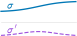 | Static Only | Shows the local slope of a nonlinear activation, used when explaining backpropagation and chain-rule gradients. |
| **bayes** *Bayes' Rule* | 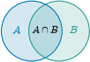 | Static Only | Represents updating a prior belief into a posterior after observing evidence. |
| **bellman** *Bellman Equation* | 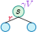 | Static Only | Summarizes recursive value decomposition in dynamic programming and reinforcement learning. |
| **brownian_motion** *Brownian Motion* | 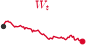 | 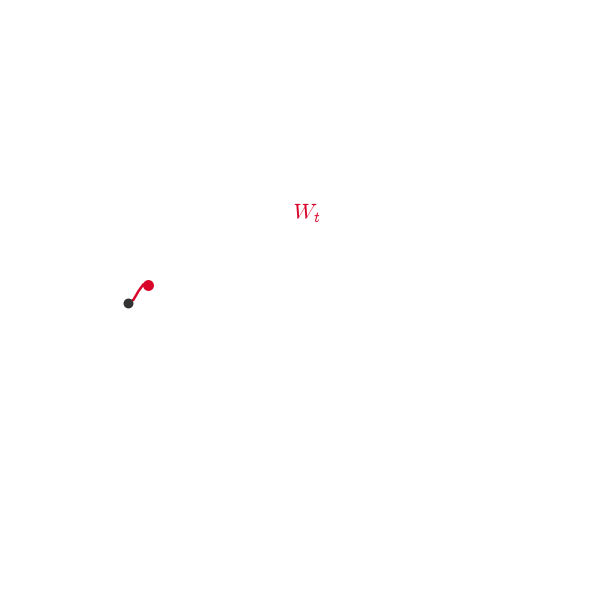 | Represents continuous random motion, the noise source behind many SDE and diffusion models. |
| **cauchy_schwarz** *Cauchy-Schwarz* | 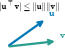 | Static Only | Represents the inner-product inequality bounding $|u^T v|$ by the product of vector norms. |
| **chain_rule** *Chain Rule* | 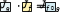 | Static Only | Shows how derivatives compose through nested functions and computational graphs. |
| **cholesky** *Cholesky Decomposition* | 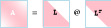 | Static Only | Represents factoring a positive-definite matrix into triangular factors. |
| **column_row_space** *Column And Row Spaces* | 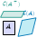 | Static Only | Highlights the fundamental subspaces associated with a matrix. |
| **convex_set** *Convex Set* | 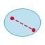 | Static Only | Shows a set where every segment between two points remains inside the set. |
| **covariance** *Covariance* |  | Static Only | Represents how variables vary together and how probability mass stretches along correlated directions. |
| **cross_entropy** *Cross Entropy* |  | Static Only | Represents the loss comparing a target distribution against predicted probabilities. |
| **denoising** *Denoising Score Matching* | 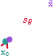 | 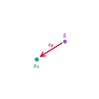 | Shows a noisy sample $\tilde{\mathbf{x}}$ converging toward clean data $\mathbf{x}_0$ along the learned score direction $s_\theta$. |
| **density_evolution** *Density Evolution* | 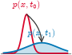 | 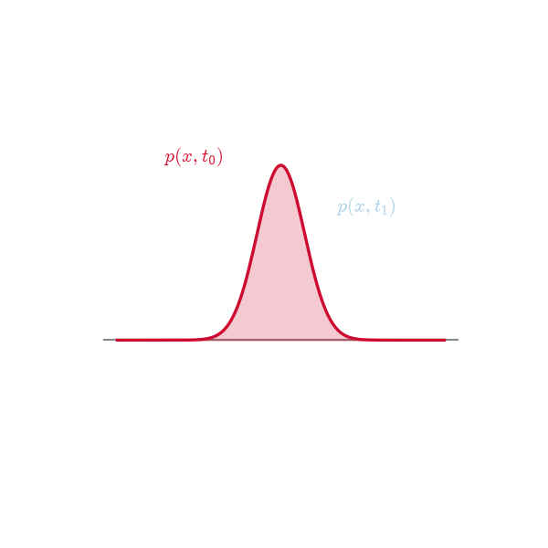 | Shows a probability density $p(x,t)$ spreading and flattening under Fokker–Planck diffusion from $t_0$ to $t_1$. |
| **det_area** *Determinant As Area* | 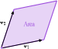 | Static Only | Shows determinant magnitude as the area or volume scaling induced by a linear map. |
| **diffusion_model** *Diffusion Model* | 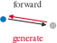 | Static Only | Represents the noise-to-data generative process used in modern diffusion models. |
| **diffusion_scores** *Diffusion Scores* | 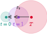 | 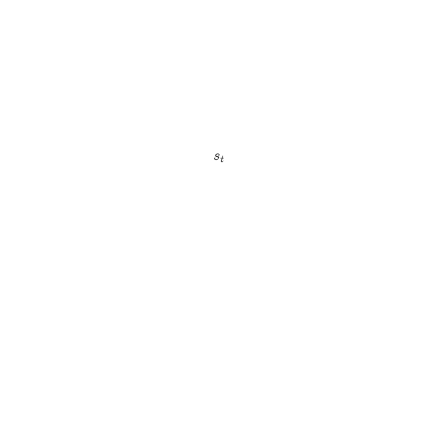 | Shows score fields $s_t(\mathbf{x})$ at increasing noise levels $t{=}0, t{=}1, \ldots, T$ in a diffusion process. |
| **eigendecomp** *Eigendecomposition* | 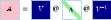 | Static Only | Shows a matrix decomposed into eigenvectors and eigenvalues. |
| **elbo** *ELBO* | 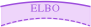 | Static Only | Represents the evidence lower bound used in variational inference and latent-variable models. |
| **entropy** *Entropy* | 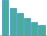 | Static Only | Represents uncertainty, spread, or information content in a probability distribution. |
| **flow_attractors** *Flow Attractors* | 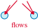 | 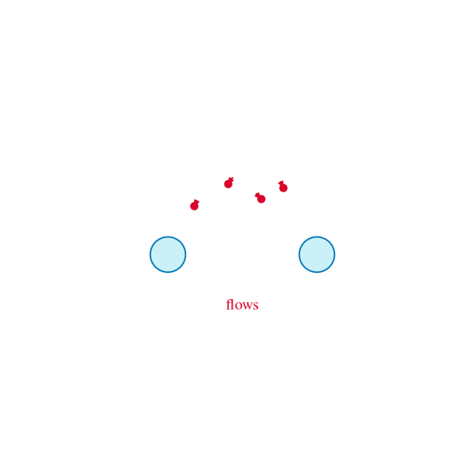 | Shows score-induced flows converging toward density modes (attractors) of a multimodal distribution. |
| **fokker_planck** *Fokker-Planck Equation* | 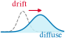 | Static Only | Shows the time evolution of a probability density under stochastic dynamics. |
| **forward_diffusion** *Forward Diffusion* | 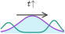 | 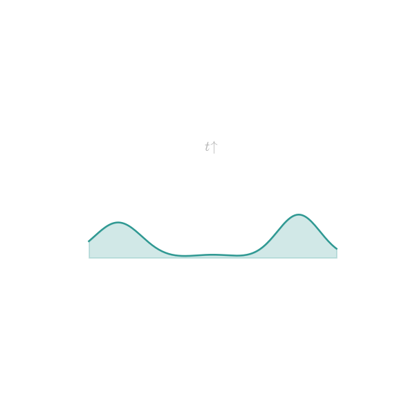 | Forward diffusion corrupts a structured data density (bimodal $p_{\mathrm{data}}$) into a wide Gaussian noise distribution as $t \uparrow$; animation shows peaks merging and flattening. |
| **frechet** *Fréchet Derivative* | 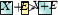 | Static Only | Represents the derivative of a map between normed spaces, generalizing the Jacobian to infinite dimensions. |
| **gaussian** *Gaussian Distribution* | 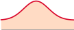 | Static Only | Represents the normal distribution and its mean/covariance geometry. |
| **gradient** *Gradient* | 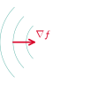 | Static Only | Shows the direction of steepest local increase for a scalar function. |
| **gram_schmidt** *Gram-Schmidt* | 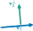 | Static Only | Represents turning a list of vectors into an orthonormal basis by subtracting projections. |
| **hessian** *Hessian* | 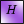 | Static Only | Represents second-order curvature information for scalar functions. |
| **householder** *Householder Reflection* | 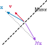 | Static Only | Shows reflection-based orthogonal transformations used in QR factorization. |
| **jacobian** *Jacobian* |  | Static Only | Represents the matrix of first derivatives for a vector-valued map. |
| **kl** *KL Divergence* | 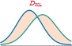 | Static Only | Represents the directed mismatch between two probability distributions. |
| **kronecker** *Kronecker Product* | 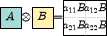 | Static Only | Shows block-structured multiplication between matrices. |
| **langevin_sampling** *Langevin Sampling* | 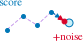 | 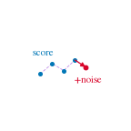 | Langevin MCMC chain: each step follows score-driven drift (blue) plus injected noise (red), gradually exploring toward a density mode. |
| **langevin_step** *Langevin Step* | 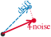 | 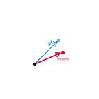 | Single Langevin update from $x_k$: dashed blue drift along $\nabla\log p$ versus red step that adds a noise kick beyond the drift target. |
| **level_set_normal** *Gradient Normal to a Level Set* | 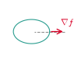 | Static Only | Shows the gradient as a vector normal to level sets of a scalar field. |
| **lu** *LU Factorization* | 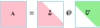 | Static Only | Represents decomposing a matrix into lower and upper triangular factors. |
| **markov** *Markov Chain* | 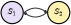 | Static Only | Shows state transitions where the next state depends only on the current state. |
| **matrix_exponential** *Matrix Exponential* | 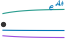 | Static Only | Represents exp(A), the operator used to solve linear differential equations. |
| **mutual_info** *Mutual Information* | 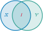 | Static Only | Represents shared information between random variables. |
| **newton** *Newton Method* | 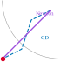 | Static Only | Shows curvature-aware optimization using gradient and Hessian information. |
| **noise_exploration** *Noise Exploration* | 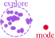 | 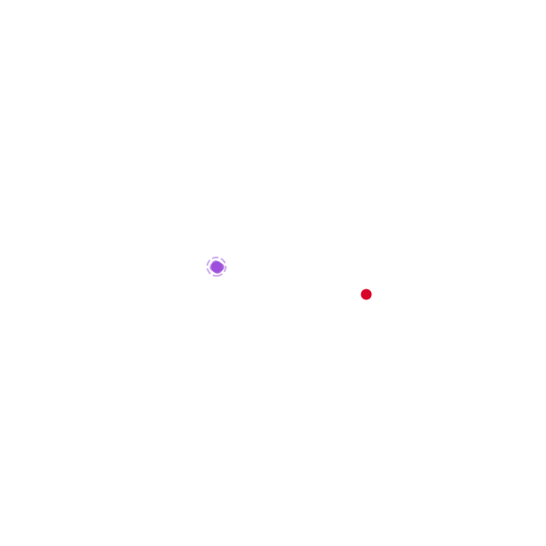 | Contrasts noise-driven exploration: a purple sample cloud spreads inside the dashed region while a red mode point stays sharp. |
| **norms** *Vector Norms* | 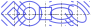 | Static Only | Compares different notions of vector length and their unit-ball geometry. |
| **orthonormal_matrix** *Orthonormal Matrix* | 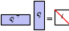 | Static Only | Represents matrices whose columns or rows preserve lengths and angles. |
| **polar** *Polar Decomposition* | 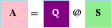 | Static Only | Shows a matrix split into a rotation/reflection part and a symmetric stretch. |
| **policy_gradient** *Policy Gradient* | 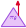 | Static Only | Represents optimizing a reinforcement-learning policy by following reward gradients. |
| **probability_current** *Probability Current* |  |  | Continuity equation in a control volume: blue $J_{\mathrm{in}}$ exceeds red $J_{\mathrm{out}}$ early so $p$ builds, then flux balances at $\partial_t p + \nabla\cdot J = 0$. |
| **projection** *Projection* |  | Static Only | Shows dropping a vector onto a subspace and separating residual error. |
| **pseudoinverse** *Pseudoinverse* |  | Static Only | Represents the generalized inverse used for least-squares and rank-deficient systems. |
| **qr** *QR Factorization* |  | Static Only | Represents decomposing a matrix into an orthonormal factor Q and triangular factor R. |
| **rayleigh** *Rayleigh Quotient* |  | Static Only | Shows how a vector probes eigenvalue-like curvature of a symmetric matrix. |
| **reverse_sde** *Reverse SDE* |  |  | Time-reversed SDE denoises a sample from noise (gray, right) back to data (blue, left); animation traces the state along the red reverse arrow opposite the black forward corruption path. |
| **rotation** *Rotation* |  |  | Represents a length-preserving turn in the plane. |
| **scalar_vector** *Scalar vs Vector Fields* |  | Static Only | Contrasts a scalar field (one value per point) with a vector field (direction and magnitude at each point). |
| **scaling** *Scaling* |  |  | Represents axis-aligned stretching or compression of space by a diagonal linear map. |
| **schur** *Schur Decomposition* |  | Static Only | Represents triangularization by a unitary or orthogonal change of basis. |
| **score_field** *Score Field* |  |  | Visualizes ∇_x log p(x) as arrows over a density landscape. |
| **score_function** *Score Function* |  | Static Only | Represents the gradient of log-density, pointing toward higher probability. |
| **score_matching** *Score Matching* |  | Static Only | Represents learning a score field directly from samples or noisy samples. |
| **sde_path** *SDE Sample Path* |  |  | Continuous-time SDE sample path $x_t$ driven by Brownian noise; animation grows the noisy trajectory from $t{=}0$ to $T$ along the time axis. |
| **sgld** *SGLD* |  | Static Only | Represents stochastic-gradient Langevin dynamics for noisy optimization and sampling. |
| **shear** *Shear* |  |  | Represents a shear transformation that slants one axis relative to the other while preserving area. |
| **spectral** *Spectral View* |  | Static Only | Represents reasoning through eigenvalues, singular values, or frequency-like modes. |
| **ste_subgradient** *Straight-Through Estimator & Subgradient* |  | Static Only | Shows subgradients at nondifferentiable points and the straight-through estimator used in discrete layers. |
| **svd** *Singular Value Decomposition* |  | Static Only | Shows a matrix as rotations/reflections plus axis-aligned stretching. |
| **taylor** *Taylor Approximation* |  | Static Only | Represents local polynomial approximation of a function. |
| **tensor_block** *Volumetric 3D Tensor Block* |  | Static Only | Represents a 3D volumetric tensor (Channels, Height, Width) projected onto a 2D isometric grid, useful for neural network layout blocks. |
| **three_levels** *Paths vs Densities: Three Levels* |  |  | Path-level SDEs (top), probability-flow ODE (middle), and Fokker--Planck density (bottom); animation advances time so sample paths extend, flow grows, and $p(x,t)$ spreads. |
| **trust_region** *Trust Region* |  | Static Only | Shows constrained local optimization inside a region where the model is trusted. |
| **value_iteration** *Value Iteration* |  | Static Only | Represents repeatedly applying Bellman updates to compute values. |

## Matrix Icons
Matrix shapes and layouts using the book legend color scheme (`chapterx/img/legend.py`). Use these ids in mindmaps for consistent matrix taxonomy.

| Key / Title | Static Image | Loopable GIF | Concept & Role |
| :--- | :---: | :---: | :--- |
| **antidiagonal_matrix** *Antidiagonal Matrix* |  | Static Only | Mindmap icon for Antidiagonal Matrix. Used to represent the antidiagonal matrix concept in Math4AI diagrams. |
| **column_vector** *Column Vector* |  | Static Only | Mindmap icon for Column Vector. Used to represent the column vector concept in Math4AI diagrams. |
| **diagonal_matrix** *Diagonal Matrix* |  | Static Only | Mindmap icon for Diagonal Matrix. Used to represent the diagonal matrix concept in Math4AI diagrams. |
| **eigenvector_matrix** *Eigenvector Matrix* |  | Static Only | Mindmap icon for Eigenvector Matrix. Used to represent the eigenvector matrix concept in Math4AI diagrams. |
| **generalized_upper_triangular_matrix** *Generalized Upper Triangular Matrix* |  | Static Only | Mindmap icon for Generalized Upper Triangular Matrix. Used to represent the generalized upper triangular matrix concept in Math4AI diagrams. |
| **lower_triangular_matrix** *Lower Triangular Matrix* |  | Static Only | Mindmap icon for Lower Triangular Matrix. Used to represent the lower triangular matrix concept in Math4AI diagrams. |
| **lower_unit_triangular_matrix** *Lower Unit Triangular Matrix* |  | Static Only | Mindmap icon for Lower Unit Triangular Matrix. Used to represent the lower unit triangular matrix concept in Math4AI diagrams. |
| **nonnegative_matrix** *Nonnegative Matrix* |  | Static Only | Mindmap icon for Nonnegative Matrix. Used to represent the nonnegative matrix concept in Math4AI diagrams. |
| **orthogonal_matrix** *Orthogonal Matrix* |  | Static Only | Mindmap icon for Orthogonal Matrix. Used to represent the orthogonal matrix concept in Math4AI diagrams. |
| **permutation_matrix** *Permutation Matrix* |  | Static Only | Mindmap icon for Permutation Matrix. Used to represent the permutation matrix concept in Math4AI diagrams. |
| **rect_matrix** *Rect Matrix* |  | Static Only | Mindmap icon for Rect Matrix. Used to represent the rect matrix concept in Math4AI diagrams. |
| **rectangular_matrix** *Rectangular Matrix* |  | Static Only | Mindmap icon for Rectangular Matrix. Used to represent the rectangular matrix concept in Math4AI diagrams. |
| **row_vector** *Row Vector* |  | Static Only | Mindmap icon for Row Vector. Used to represent the row vector concept in Math4AI diagrams. |
| **square_matrix** *Square Matrix* |  | Static Only | Mindmap icon for Square Matrix. Used to represent the square matrix concept in Math4AI diagrams. |
| **symmetric_matrix** *Symmetric Matrix* |  | Static Only | Mindmap icon for Symmetric Matrix. Used to represent the symmetric matrix concept in Math4AI diagrams. |
| **tall_matrix** *Tall Matrix* |  | Static Only | Mindmap icon for Tall Matrix. Used to represent the tall matrix concept in Math4AI diagrams. |
| **triangular_matrix** *Triangular Matrix* |  | Static Only | Mindmap icon for Triangular Matrix. Used to represent the triangular matrix concept in Math4AI diagrams. |
| **upper_triangular_matrix** *Upper Triangular Matrix* |  | Static Only | Mindmap icon for Upper Triangular Matrix. Used to represent the upper triangular matrix concept in Math4AI diagrams. |
| **wide_matrix** *Wide Matrix* |  | Static Only | Mindmap icon for Wide Matrix. Used to represent the wide matrix concept in Math4AI diagrams. |

## Neural Network Icons
Architecture diagrams rendered with [visualtorch](https://github.com/willyfh/visualtorch). Requires `pip install mathicon[nn]` (torch + aggdraw).

| Key / Title | Static Image | Loopable GIF | Concept & Role |
| :--- | :---: | :---: | :--- |
| **nn_mlp** *Neural Network MLP* |  | Static Only | Minimal dense feedforward network (2→3→2) as a node-link graph (visualtorch graph style). |

## Other Miscellaneous Icons

| Key / Title | Static Image | Loopable GIF | Concept & Role |
| :--- | :---: | :---: | :--- |
| **basis_dim** *Basis Dim* |  | Static Only | Mindmap icon for Basis Dim. Used to represent the basis dim concept in Math4AI diagrams. |
| **bellman_backup** *Bellman Backup* |  | Static Only | Mindmap icon for Bellman Backup. Used to represent the bellman backup concept in Math4AI diagrams. |
| **beta_dirichlet_vmf** *Beta Dirichlet Vmf* |  | Static Only | Mindmap icon for Beta Dirichlet Vmf. Used to represent the beta dirichlet vmf concept in Math4AI diagrams. |
| **block_lu** *Block Lu* |  | Static Only | Mindmap icon for Block Lu. Used to represent the block lu concept in Math4AI diagrams. |
| **block_matrix** *Block Matrix* |  | Static Only | Mindmap icon for Block Matrix. Used to represent the block matrix concept in Math4AI diagrams. |
| **column_span** *Column Span* |  | Static Only | Mindmap icon for Column Span. Used to represent the column span concept in Math4AI diagrams. |
| **contraction** *Contraction* |  | Static Only | Mindmap icon for Contraction. Used to represent the contraction concept in Math4AI diagrams. |
| **ctmc** *Ctmc* |  | Static Only | Mindmap icon for Ctmc. Used to represent the ctmc concept in Math4AI diagrams. |
| **ddim** *Ddim* |  | Static Only | Mindmap icon for Ddim. Used to represent the ddim concept in Math4AI diagrams. |
| **definiteness** *Definiteness* |  | Static Only | Mindmap icon for Definiteness. Used to represent the definiteness concept in Math4AI diagrams. |
| **detailed_balance** *Detailed Balance* |  | Static Only | Mindmap icon for Detailed Balance. Used to represent the detailed balance concept in Math4AI diagrams. |
| **diffusion_unify** *Diffusion Unify* |  | Static Only | Mindmap icon for Diffusion Unify. Used to represent the diffusion unify concept in Math4AI diagrams. |
| **duality** *Duality* |  | Static Only | Mindmap icon for Duality. Used to represent the duality concept in Math4AI diagrams. |
| **ebm** *Ebm* |  | Static Only | Mindmap icon for Ebm. Used to represent the ebm concept in Math4AI diagrams. |
| **eigen_stability** *Eigen Stability* |  | Static Only | Mindmap icon for Eigen Stability. Used to represent the eigen stability concept in Math4AI diagrams. |
| **eigenvector_scaling** *Eigenvector Scaling* |  | Static Only | Mindmap icon for Eigenvector Scaling. Used to represent the eigenvector scaling concept in Math4AI diagrams. |
| **ellipsoid** *Ellipsoid* |  | Static Only | Mindmap icon for Ellipsoid. Used to represent the ellipsoid concept in Math4AI diagrams. |
| **em** *Em* |  | Static Only | Mindmap icon for Em. Used to represent the em concept in Math4AI diagrams. |
| **euler_bilinear** *Euler Bilinear* |  | Static Only | Mindmap icon for Euler Bilinear. Used to represent the euler bilinear concept in Math4AI diagrams. |
| **euler_maruyama** *Euler Maruyama* |  | Static Only | Mindmap icon for Euler Maruyama. Used to represent the euler maruyama concept in Math4AI diagrams. |
| **expectation** *Expectation* |  | Static Only | Mindmap icon for Expectation. Used to represent the expectation concept in Math4AI diagrams. |
| **f_divergence** *F Divergence* |  | Static Only | Mindmap icon for F Divergence. Used to represent the f divergence concept in Math4AI diagrams. |
| **fast_sampler** *Fast Sampler* |  | Static Only | Mindmap icon for Fast Sampler. Used to represent the fast sampler concept in Math4AI diagrams. |
| **fisher_divergence** *Fisher Divergence* |  | Static Only | Mindmap icon for Fisher Divergence. Used to represent the fisher divergence concept in Math4AI diagrams. |
| **fisher_info** *Fisher Info* |  | Static Only | Mindmap icon for Fisher Info. Used to represent the fisher info concept in Math4AI diagrams. |
| **generative_compare** *Generative Compare* |  | Static Only | Mindmap icon for Generative Compare. Used to represent the generative compare concept in Math4AI diagrams. |
| **gmm** *Gmm* |  | Static Only | Mindmap icon for Gmm. Used to represent the gmm concept in Math4AI diagrams. |
| **gptq_hessian** *Gptq Hessian* |  | Static Only | Mindmap icon for Gptq Hessian. Used to represent the gptq hessian concept in Math4AI diagrams. |
| **gram** *Gram* |  | Static Only | Mindmap icon for Gram. Used to represent the gram concept in Math4AI diagrams. |
| **graph_laplacian** *Graph Laplacian* |  | Static Only | Mindmap icon for Graph Laplacian. Used to represent the graph laplacian concept in Math4AI diagrams. |
| **hadamard_outer** *Hadamard Outer* |  | Static Only | Mindmap icon for Hadamard Outer. Used to represent the hadamard outer concept in Math4AI diagrams. |
| **independence** *Independence* |  | Static Only | Mindmap icon for Independence. Used to represent the independence concept in Math4AI diagrams. |
| **interpolative_decomposition** *Interpolative Decomposition* |  | Static Only | Mindmap icon for Interpolative Decomposition. Used to represent the interpolative decomposition concept in Math4AI diagrams. |
| **intractable_posterior** *Intractable Posterior* |  | Static Only | Mindmap icon for Intractable Posterior. Used to represent the intractable posterior concept in Math4AI diagrams. |
| **ito_lemma** *Ito Lemma* |  | Static Only | Mindmap icon for Ito Lemma. Used to represent the ito lemma concept in Math4AI diagrams. |
| **ito_vs_strat** *Ito Vs Strat* |  | Static Only | Mindmap icon for Ito Vs Strat. Used to represent the ito vs strat concept in Math4AI diagrams. |
| **joint_marginal** *Joint Marginal* |  | Static Only | Mindmap icon for Joint Marginal. Used to represent the joint marginal concept in Math4AI diagrams. |
| **kkt** *Kkt* |  | Static Only | Mindmap icon for Kkt. Used to represent the kkt concept in Math4AI diagrams. |
| **kron_properties** *Kron Properties* |  | Static Only | Mindmap icon for Kron Properties. Used to represent the kron properties concept in Math4AI diagrams. |
| **kron_vector** *Kron Vector* |  | Static Only | Mindmap icon for Kron Vector. Used to represent the kron vector concept in Math4AI diagrams. |
| **langevin_equation** *Langevin Equation* |  | Static Only | Mindmap icon for Langevin Equation. Used to represent the langevin equation concept in Math4AI diagrams. |
| **latent_model** *Latent Model* |  | Static Only | Mindmap icon for Latent Model. Used to represent the latent model concept in Math4AI diagrams. |
| **ldlt_decomposition** *Ldlt Decomposition* |  | Static Only | Mindmap icon for Ldlt Decomposition. Used to represent the ldlt decomposition concept in Math4AI diagrams. |
| **lin_indep** *Lin Indep* |  | Static Only | Mindmap icon for Lin Indep. Used to represent the lin indep concept in Math4AI diagrams. |
| **low_rank_adaptation** *Low Rank Adaptation* |  | Static Only | Mindmap icon for Low Rank Adaptation. Used to represent the low rank adaptation concept in Math4AI diagrams. |
| **lower_diagonal_upper_decomposition** *Lower Diagonal Upper Decomposition* |  | Static Only | Mindmap icon for Lower Diagonal Upper Decomposition. Used to represent the lower diagonal upper decomposition concept in Math4AI diagrams. |
| **lq_decomposition** *Lq Decomposition* |  | Static Only | Mindmap icon for Lq Decomposition. Used to represent the lq decomposition concept in Math4AI diagrams. |
| **mala** *Mala* |  | Static Only | Mindmap icon for Mala. Used to represent the mala concept in Math4AI diagrams. |
| **mdp** *Mdp* |  | Static Only | Mindmap icon for Mdp. Used to represent the mdp concept in Math4AI diagrams. |
| **mean_field** *Mean Field* |  | Static Only | Mindmap icon for Mean Field. Used to represent the mean field concept in Math4AI diagrams. |
| **nonlinear_activation** *Nonlinear Activation* |  | Static Only | Mindmap icon for Nonlinear Activation. Used to represent the nonlinear activation concept in Math4AI diagrams. |
| **nonnegative_matrix_factorization** *Nonnegative Matrix Factorization* |  | Static Only | Mindmap icon for Nonnegative Matrix Factorization. Used to represent the nonnegative matrix factorization concept in Math4AI diagrams. |
| **null_space** *Null Space* |  | Static Only | Mindmap icon for Null Space. Used to represent the null space concept in Math4AI diagrams. |
| **ortho** *Ortho* |  | Static Only | Mindmap icon for Ortho. Used to represent the ortho concept in Math4AI diagrams. |
| **orthonormal_inverse** *Orthonormal Inverse* |  | Static Only | Mindmap icon for Orthonormal Inverse. Used to represent the orthonormal inverse concept in Math4AI diagrams. |
| **ou_heat** *Ou Heat* |  | Static Only | Mindmap icon for Ou Heat. Used to represent the ou heat concept in Math4AI diagrams. |
| **partition_z** *Partition Z* |  | Static Only | Mindmap icon for Partition Z. Used to represent the partition z concept in Math4AI diagrams. |
| **permuted_lu_decomposition** *Permuted Lu Decomposition* |  | Static Only | Mindmap icon for Permuted Lu Decomposition. Used to represent the permuted lu decomposition concept in Math4AI diagrams. |
| **placeholder** *Placeholder* |  | Static Only | Mindmap icon for Placeholder. Used to represent the placeholder concept in Math4AI diagrams. |
| **power_method** *Power Method* |  | Static Only | Mindmap icon for Power Method. Used to represent the power method concept in Math4AI diagrams. |
| **preservation** *Preservation* |  | Static Only | Mindmap icon for Preservation. Used to represent the preservation concept in Math4AI diagrams. |
| **proj** *Proj* |  | Static Only | Mindmap icon for Proj. Used to represent the proj concept in Math4AI diagrams. |
| **quadratic_variation** *Quadratic Variation* |  | Static Only | Mindmap icon for Quadratic Variation. Used to represent the quadratic variation concept in Math4AI diagrams. |
| **randomized_svd** *Randomized Svd* |  | Static Only | Mindmap icon for Randomized Svd. Used to represent the randomized svd concept in Math4AI diagrams. |
| **rank1** *Rank1* |  | Static Only | Mindmap icon for Rank1. Used to represent the rank1 concept in Math4AI diagrams. |
| **rank_revealing_qr** *Rank Revealing Qr* |  | Static Only | Mindmap icon for Rank Revealing Qr. Used to represent the rank revealing qr concept in Math4AI diagrams. |
| **reflection** *Reflection* |  | Static Only | Mindmap icon for Reflection. Used to represent the reflection concept in Math4AI diagrams. |
| **reparam** *Reparam* |  | Static Only | Mindmap icon for Reparam. Used to represent the reparam concept in Math4AI diagrams. |
| **reverse_fp** *Reverse Fp* |  | Static Only | Mindmap icon for Reverse Fp. Used to represent the reverse fp concept in Math4AI diagrams. |
| **rope** *Rope* |  | Static Only | Mindmap icon for Rope. Used to represent the rope concept in Math4AI diagrams. |
| **rotation_circle** *Rotation Circle* |  | Static Only | Mindmap icon for Rotation Circle. Used to represent the rotation circle concept in Math4AI diagrams. |
| **saddle_point** *Saddle Point* |  | Static Only | Mindmap icon for Saddle Point. Used to represent the saddle point concept in Math4AI diagrams. |
| **schur_complement** *Schur Complement* |  | Static Only | Mindmap icon for Schur Complement. Used to represent the schur complement concept in Math4AI diagrams. |
| **schur_gp** *Schur Gp* |  | Static Only | Mindmap icon for Schur Gp. Used to represent the schur gp concept in Math4AI diagrams. |
| **sde_definition** *Sde Definition* |  | Static Only | Mindmap icon for Sde Definition. Used to represent the sde definition concept in Math4AI diagrams. |
| **sde_optim_limit** *Sde Optim Limit* |  | Static Only | Mindmap icon for Sde Optim Limit. Used to represent the sde optim limit concept in Math4AI diagrams. |
| **sphere_ellipse** *Sphere Ellipse* |  | Static Only | Mindmap icon for Sphere Ellipse. Used to represent the sphere ellipse concept in Math4AI diagrams. |
| **ssm** *Ssm* |  | Static Only | Mindmap icon for Ssm. Used to represent the ssm concept in Math4AI diagrams. |
| **stable_discretization** *Stable Discretization* |  | Static Only | Mindmap icon for Stable Discretization. Used to represent the stable discretization concept in Math4AI diagrams. |
| **state_space_model** *State Space Model* |  | Static Only | Mindmap icon for State Space Model. Used to represent the state space model concept in Math4AI diagrams. |
| **stochastic_variational_inference** *Stochastic Variational Inference* |  | Static Only | Mindmap icon for Stochastic Variational Inference. Used to represent the stochastic variational inference concept in Math4AI diagrams. |
| **subspaces** *Subspaces* |  | Static Only | Mindmap icon for Subspaces. Used to represent the subspaces concept in Math4AI diagrams. |
| **svd_mapping** *Svd Mapping* |  | Static Only | Mindmap icon for Svd Mapping. Used to represent the svd mapping concept in Math4AI diagrams. |
| **tensor_parallel** *Tensor Parallel* |  | Static Only | Mindmap icon for Tensor Parallel. Used to represent the tensor parallel concept in Math4AI diagrams. |
| **tensor_train** *Tensor Train* |  | Static Only | Mindmap icon for Tensor Train. Used to represent the tensor train concept in Math4AI diagrams. |
| **truncated_svd** *Truncated Svd* |  | Static Only | Mindmap icon for Truncated Svd. Used to represent the truncated svd concept in Math4AI diagrams. |
| **var_family** *Var Family* |  | Static Only | Mindmap icon for Var Family. Used to represent the var family concept in Math4AI diagrams. |
| **weyl_bounds** *Weyl Bounds* |  | Static Only | Mindmap icon for Weyl Bounds. Used to represent the weyl bounds concept in Math4AI diagrams. |
| **zoh** *Zoh* |  | Static Only | Mindmap icon for Zoh. Used to represent the zoh concept in Math4AI diagrams. |

