# Icons reference gallery

Welcome to the complete Mathicon gallery. This reference page is automatically compiled, showcasing all built-in static and animated icons.

## Mathematical Primitives & Core Topics
These icons represent specific mathematical topics and are matched to the chapters of the *Mathematics for AI* textbook.

| Key / Title | Static Image | Loopable GIF | Concept & Role |
| :--- | :---: | :---: | :--- |
| **activation_deriv** *Activation Derivative* |  | Static Only | Shows the local slope of a nonlinear activation, used when explaining backpropagation and chain-rule gradients. |
| **bayes** *Bayes' Rule* |  | Static Only | Represents updating a prior belief into a posterior after observing evidence. |
| **bellman** *Bellman Equation* |  | Static Only | Summarizes recursive value decomposition in dynamic programming and reinforcement learning. |
| **brownian_motion** *Brownian Motion* |  |  | Represents continuous random motion, the noise source behind many SDE and diffusion models. |
| **chain_rule** *Chain Rule* |  | Static Only | Shows how derivatives compose through nested functions and computational graphs. |
| **cholesky** *Cholesky Decomposition* |  | Static Only | Represents factoring a positive-definite matrix into triangular factors. |
| **column_row_space** *Column And Row Spaces* |  | Static Only | Highlights the fundamental subspaces associated with a matrix. |
| **convex_set** *Convex Set* |  | Static Only | Shows a set where every segment between two points remains inside the set. |
| **covariance** *Covariance* |  | Static Only | Represents how variables vary together and how probability mass stretches along correlated directions. |
| **cross_entropy** *Cross Entropy* |  | Static Only | Represents the loss comparing a target distribution against predicted probabilities. |
| **det_area** *Determinant As Area* |  | Static Only | Shows determinant magnitude as the area or volume scaling induced by a linear map. |
| **diffusion_model** *Diffusion Model* |  | Static Only | Represents the noise-to-data generative process used in modern diffusion models. |
| **eigendecomp** *Eigendecomposition* |  | Static Only | Shows a matrix decomposed into eigenvectors and eigenvalues. |
| **elbo** *ELBO* |  | Static Only | Represents the evidence lower bound used in variational inference and latent-variable models. |
| **entropy** *Entropy* |  | Static Only | Represents uncertainty, spread, or information content in a probability distribution. |
| **fokker_planck** *Fokker-Planck Equation* |  | Static Only | Shows the time evolution of a probability density under stochastic dynamics. |
| **frechet** *Fréchet Derivative* |  | Static Only | No description provided. |
| **gaussian** *Gaussian Distribution* |  | Static Only | Represents the normal distribution and its mean/covariance geometry. |
| **gradient** *Gradient* |  | Static Only | Shows the direction of steepest local increase for a scalar function. |
| **gram_schmidt** *Gram-Schmidt* |  | Static Only | Represents turning a list of vectors into an orthonormal basis by subtracting projections. |
| **hessian** *Hessian* |  | Static Only | Represents second-order curvature information for scalar functions. |
| **householder** *Householder Reflection* |  | Static Only | Shows reflection-based orthogonal transformations used in QR factorization. |
| **jacobian** *Jacobian* |  | Static Only | Represents the matrix of first derivatives for a vector-valued map. |
| **kl** *KL Divergence* |  | Static Only | Represents the directed mismatch between two probability distributions. |
| **kronecker** *Kronecker Product* |  | Static Only | Shows block-structured multiplication between matrices. |
| **langevin_sampling** *Langevin Sampling* |  |  | Represents gradient-guided noisy sampling from an energy or probability density. |
| **level_set_normal** *Gradient Normal to a Level Set* |  | Static Only | No description provided. |
| **markov** *Markov Chain* |  | Static Only | Shows state transitions where the next state depends only on the current state. |
| **matrix_exponential** *Matrix Exponential* |  | Static Only | Represents exp(A), the operator used to solve linear differential equations. |
| **mutual_info** *Mutual Information* |  | Static Only | Represents shared information between random variables. |
| **newton** *Newton Method* |  | Static Only | Shows curvature-aware optimization using gradient and Hessian information. |
| **norms** *Vector Norms* |  | Static Only | Compares different notions of vector length and their unit-ball geometry. |
| **orthonormal_matrix** *Orthonormal Matrix* |  | Static Only | Represents matrices whose columns or rows preserve lengths and angles. |
| **polar** *Polar Decomposition* |  | Static Only | Shows a matrix split into a rotation/reflection part and a symmetric stretch. |
| **policy_gradient** *Policy Gradient* |  | Static Only | Represents optimizing a reinforcement-learning policy by following reward gradients. |
| **projection** *Projection* |  | Static Only | Shows dropping a vector onto a subspace and separating residual error. |
| **pseudoinverse** *Pseudoinverse* |  | Static Only | Represents the generalized inverse used for least-squares and rank-deficient systems. |
| **rayleigh** *Rayleigh Quotient* |  | Static Only | Shows how a vector probes eigenvalue-like curvature of a symmetric matrix. |
| **rotation** *Rotation* |  |  | Represents a length-preserving turn in the plane. |
| **scalar_vector** *Scalar vs Vector Fields* |  | Static Only | No description provided. |
| **schur** *Schur Decomposition* |  | Static Only | Represents triangularization by a unitary or orthogonal change of basis. |
| **score_field** *Score Field* |  |  | Visualizes ∇_x log p(x) as arrows over a density landscape. |
| **score_function** *Score Function* |  | Static Only | Represents the gradient of log-density, pointing toward higher probability. |
| **score_matching** *Score Matching* |  | Static Only | Represents learning a score field directly from samples or noisy samples. |
| **sgld** *SGLD* |  | Static Only | Represents stochastic-gradient Langevin dynamics for noisy optimization and sampling. |
| **spectral** *Spectral View* |  | Static Only | Represents reasoning through eigenvalues, singular values, or frequency-like modes. |
| **ste_subgradient** *Straight-Through Estimator & Subgradient* |  | Static Only | No description provided. |
| **taylor** *Taylor Approximation* |  | Static Only | Represents local polynomial approximation of a function. |
| **trust_region** *Trust Region* |  | Static Only | Shows constrained local optimization inside a region where the model is trusted. |
| **value_iteration** *Value Iteration* |  | Static Only | Represents repeatedly applying Bellman updates to compute values. |

## Base Matrix Shapes & Basic Layouts
These utility icons are used to represent standard matrix patterns (like upper triangular, row/column vectors, etc.) in mathematical diagrams.

| Key / Title | Static Image | Loopable GIF | Concept & Role |
| :--- | :---: | :---: | :--- |
| **antidiagonal_matrix** *Antidiagonal Matrix* |  | Static Only | No description provided. |
| **block_matrix** *Block Matrix* |  | Static Only | No description provided. |
| **column_span** *Column Span* |  | Static Only | No description provided. |
| **column_vector** *Column Vector* |  | Static Only | No description provided. |
| **diagonal_matrix** *Diagonal Matrix* |  | Static Only | No description provided. |
| **kron_vector** *Kron Vector* |  | Static Only | No description provided. |
| **lower_triangular_matrix** *Lower Triangular Matrix* |  | Static Only | No description provided. |
| **nonnegative_matrix_factorization** *Nonnegative Matrix Factorization* |  | Static Only | No description provided. |
| **row_vector** *Row Vector* |  | Static Only | No description provided. |
| **square_matrix** *Square Matrix* |  | Static Only | No description provided. |
| **tall_matrix** *Tall Matrix* |  | Static Only | No description provided. |
| **upper_triangular_matrix** *Upper Triangular Matrix* |  | Static Only | No description provided. |
| **wide_matrix** *Wide Matrix* |  | Static Only | No description provided. |

## Legend Matrix Styles
These stylized icons are used to render key legends and specialized color codings in matrix diagrams.

| Key / Title | Static Image | Loopable GIF | Concept & Role |
| :--- | :---: | :---: | :--- |
| **legend_diagonal_matrix** *Legend Diagonal Matrix* | 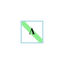 | Static Only | No description provided. |
| **legend_eigenvector_matrix** *Legend Eigenvector Matrix* |  | Static Only | No description provided. |
| **legend_generalized_upper_triangular** *Legend Generalized Upper Triangular* | 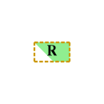 | Static Only | No description provided. |
| **legend_lower_triangular** *Legend Lower Triangular* | 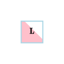 | Static Only | No description provided. |
| **legend_lower_unit_triangular** *Legend Lower Unit Triangular* | 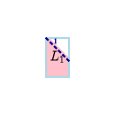 | Static Only | No description provided. |
| **legend_nonnegative_matrix** *Legend Nonnegative Matrix* |  | Static Only | No description provided. |
| **legend_orthogonal_matrix** *Legend Orthogonal Matrix* |  | Static Only | No description provided. |
| **legend_permutation_matrix** *Legend Permutation Matrix* | 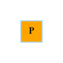 | Static Only | No description provided. |
| **legend_rectangular_matrix** *Legend Rectangular Matrix* | 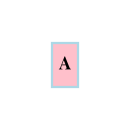 | Static Only | No description provided. |
| **legend_square_matrix** *Legend Square Matrix* | 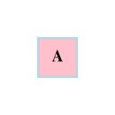 | Static Only | No description provided. |
| **legend_symmetric_matrix** *Legend Symmetric Matrix* |  | Static Only | No description provided. |
| **legend_upper_triangular** *Legend Upper Triangular* | 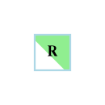 | Static Only | No description provided. |

## Other Miscellaneous Icons

| Key / Title | Static Image | Loopable GIF | Concept & Role |
| :--- | :---: | :---: | :--- |
| **basis_dim** *Basis Dim* |  | Static Only | No description provided. |
| **bellman_backup** *Bellman Backup* |  | Static Only | No description provided. |
| **beta_dirichlet_vmf** *Beta Dirichlet Vmf* |  | Static Only | No description provided. |
| **block_lu** *Block Lu* |  | Static Only | No description provided. |
| **contraction** *Contraction* |  | Static Only | No description provided. |
| **ctmc** *Ctmc* |  | Static Only | No description provided. |
| **ddim** *Ddim* |  | Static Only | No description provided. |
| **definiteness** *Definiteness* |  | Static Only | No description provided. |
| **denoising** *Denoising* |  |  | No description provided. |
| **density_evolution** *Density Evolution* |  |  | No description provided. |
| **detailed_balance** *Detailed Balance* |  | Static Only | No description provided. |
| **diffusion_scores** *Diffusion Scores* |  |  | No description provided. |
| **diffusion_unify** *Diffusion Unify* |  | Static Only | No description provided. |
| **duality** *Duality* |  | Static Only | No description provided. |
| **ebm** *Ebm* |  | Static Only | No description provided. |
| **eigen_stability** *Eigen Stability* |  | Static Only | No description provided. |
| **eigenvector_scaling** *Eigenvector Scaling* |  | Static Only | No description provided. |
| **ellipsoid** *Ellipsoid* |  | Static Only | No description provided. |
| **em** *Em* |  | Static Only | No description provided. |
| **euler_bilinear** *Euler Bilinear* |  | Static Only | No description provided. |
| **euler_maruyama** *Euler Maruyama* |  | Static Only | No description provided. |
| **expectation** *Expectation* |  | Static Only | No description provided. |
| **f_divergence** *F Divergence* |  | Static Only | No description provided. |
| **fast_sampler** *Fast Sampler* |  | Static Only | No description provided. |
| **fisher_divergence** *Fisher Divergence* |  | Static Only | No description provided. |
| **fisher_info** *Fisher Info* |  | Static Only | No description provided. |
| **flow_attractors** *Flow Attractors* |  |  | No description provided. |
| **forward_diffusion** *Forward Diffusion* |  |  | No description provided. |
| **generative_compare** *Generative Compare* |  | Static Only | No description provided. |
| **gmm** *Gmm* |  | Static Only | No description provided. |
| **gptq_hessian** *Gptq Hessian* |  | Static Only | No description provided. |
| **gram** *Gram* |  | Static Only | No description provided. |
| **graph_laplacian** *Graph Laplacian* |  | Static Only | No description provided. |
| **hadamard_outer** *Hadamard Outer* |  | Static Only | No description provided. |
| **independence** *Independence* |  | Static Only | No description provided. |
| **interpolative_decomposition** *Interpolative Decomposition* |  | Static Only | No description provided. |
| **intractable_posterior** *Intractable Posterior* |  | Static Only | No description provided. |
| **ito_lemma** *Ito Lemma* |  | Static Only | No description provided. |
| **ito_vs_strat** *Ito Vs Strat* |  | Static Only | No description provided. |
| **joint_marginal** *Joint Marginal* |  | Static Only | No description provided. |
| **kkt** *Kkt* |  | Static Only | No description provided. |
| **kron_properties** *Kron Properties* |  | Static Only | No description provided. |
| **langevin_equation** *Langevin Equation* |  | Static Only | No description provided. |
| **langevin_step** *Langevin Step* |  |  | No description provided. |
| **latent_model** *Latent Model* |  | Static Only | No description provided. |
| **ldlt_decomposition** *Ldlt Decomposition* |  | Static Only | No description provided. |
| **lin_indep** *Lin Indep* |  | Static Only | No description provided. |
| **low_rank_adaptation** *Low Rank Adaptation* |  | Static Only | No description provided. |
| **lower_diagonal_upper_decomposition** *Lower Diagonal Upper Decomposition* |  | Static Only | No description provided. |
| **lq_decomposition** *Lq Decomposition* |  | Static Only | No description provided. |
| **lu_decomposition** *Lu Decomposition* | 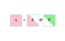 | Static Only | No description provided. |
| **mala** *Mala* |  | Static Only | No description provided. |
| **mdp** *Mdp* |  | Static Only | No description provided. |
| **mean_field** *Mean Field* |  | Static Only | No description provided. |
| **noise_exploration** *Noise Exploration* |  |  | No description provided. |
| **nonlinear_activation** *Nonlinear Activation* |  | Static Only | No description provided. |
| **null_space** *Null Space* |  | Static Only | No description provided. |
| **ortho** *Ortho* |  | Static Only | No description provided. |
| **orthonormal_inverse** *Orthonormal Inverse* |  | Static Only | No description provided. |
| **ou_heat** *Ou Heat* |  | Static Only | No description provided. |
| **partition_z** *Partition Z* |  | Static Only | No description provided. |
| **paths_flow_density** *Paths Flow Density* |  |  | No description provided. |
| **permuted_lu_decomposition** *Permuted Lu Decomposition* |  | Static Only | No description provided. |
| **placeholder** *Placeholder* |  | Static Only | No description provided. |
| **power_method** *Power Method* |  | Static Only | No description provided. |
| **preservation** *Preservation* |  | Static Only | No description provided. |
| **probability_current** *Probability Current* |  |  | No description provided. |
| **proj** *Proj* |  | Static Only | No description provided. |
| **qr_decomposition** *Qr Decomposition* | 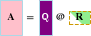 | Static Only | No description provided. |
| **quadratic_variation** *Quadratic Variation* |  | Static Only | No description provided. |
| **randomized_svd** *Randomized Svd* |  | Static Only | No description provided. |
| **rank1** *Rank1* |  | Static Only | No description provided. |
| **rank_revealing_qr** *Rank Revealing Qr* |  | Static Only | No description provided. |
| **reflection** *Reflection* |  | Static Only | No description provided. |
| **reparam** *Reparam* |  | Static Only | No description provided. |
| **reverse_fp** *Reverse Fp* |  | Static Only | No description provided. |
| **reverse_sde** *Reverse Sde* |  |  | No description provided. |
| **rope** *Rope* |  | Static Only | No description provided. |
| **rotation_circle** *Rotation Circle* |  | Static Only | No description provided. |
| **saddle_point** *Saddle Point* |  | Static Only | No description provided. |
| **scaling** *Scaling* |  |  | No description provided. |
| **schur_complement** *Schur Complement* |  | Static Only | No description provided. |
| **schur_gp** *Schur Gp* |  | Static Only | No description provided. |
| **sde_definition** *Sde Definition* |  | Static Only | No description provided. |
| **sde_optim_limit** *Sde Optim Limit* |  | Static Only | No description provided. |
| **sde_path** *Sde Path* |  |  | No description provided. |
| **shear** *Shear* |  |  | No description provided. |
| **singular_value_decomposition** *Singular Value Decomposition* | 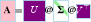 | Static Only | No description provided. |
| **skeleton** *Skeleton* | 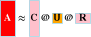 | Static Only | No description provided. |
| **sphere_ellipse** *Sphere Ellipse* |  | Static Only | No description provided. |
| **ssm** *Ssm* |  | Static Only | No description provided. |
| **stable_discretization** *Stable Discretization* |  | Static Only | No description provided. |
| **state_space_model** *State Space Model* |  | Static Only | No description provided. |
| **stochastic_variational_inference** *Stochastic Variational Inference* |  | Static Only | No description provided. |
| **subspaces** *Subspaces* |  | Static Only | No description provided. |
| **svd_mapping** *Svd Mapping* |  | Static Only | No description provided. |
| **tensor_parallel** *Tensor Parallel* |  | Static Only | No description provided. |
| **tensor_train** *Tensor Train* |  | Static Only | No description provided. |
| **truncated_svd** *Truncated Svd* |  | Static Only | No description provided. |
| **var_family** *Var Family* |  | Static Only | No description provided. |
| **weyl_bounds** *Weyl Bounds* |  | Static Only | No description provided. |
| **zoh** *Zoh* |  | Static Only | No description provided. |

